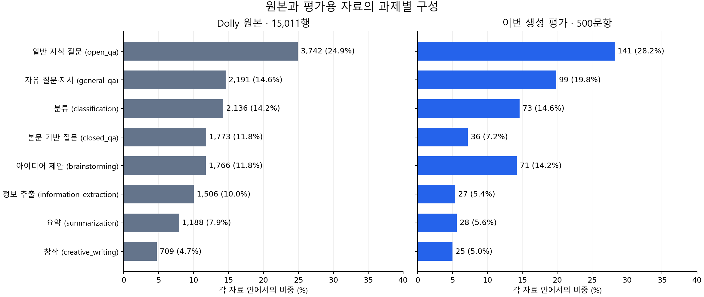

# Dolly 데이터의 구성과 이번 평가에서의 사용

확인일: 2026-10-15, Asia/Seoul. 원본 파일과 MiniLLM 공개 평가 파일을 직접 집계했다. [집계 코드](scripts/summarize_dolly.py)·[revision/파일 hash/개수](results/sft_baselines/dolly_composition.json)를 함께 보관한다.

## 원본은 무엇인가

[Databricks Dolly-15K](https://huggingface.co/datasets/databricks/databricks-dolly-15k/blob/bdd27f4d94b9c1f951818a7da7fd7aeea5dbff1a/README.md)는 Databricks 직원들이 작성한 영어 instruction-following 자료다. 제공자는 생성형 AI로 instruction·response를 작성하지 않도록 안내했다고 설명한다. 사람이 썼다는 사실이 모든 응답의 정확성을 보장하지는 않는다. 원본 라이선스 표시는 CC BY-SA 3.0이다.

고정 revision `bdd27f4d94b9c1f951818a7da7fd7aeea5dbff1a`의 JSONL 파일에는 **15,011행·8개 과제 유형**이 있다. 한 줄이 하나의 요청과 기준 응답이다.

| 원본 필드 | 내용 | SFT에서의 역할 |
|---|---|---|
| `instruction` | 요청·질문·작업 지시 | 입력 prompt의 지시 부분 |
| `context` | 주어진 본문. 없으면 빈 문자열 | 본문 기반 질문·추출·요약 등에 필요한 입력 |
| `response` | 사람이 작성한 기준 응답 | 응답 토큰의 지도 목표 |
| `category` | 과제 유형 | 과제별 분포·오류 분석용 metadata. 모든 문항에서 예측할 정답 label이라는 뜻이 아님 |

입력은 **instruction + 필요한 context**, 학습 대상은 **response**다. category를 모델이 맞힐 label로 바꿔 학습한 실험은 아니다. context가 있는 원본은 **4,467행(29.76%)**, 없는 원본은 **10,544행(70.24%)**다.

## 과제별 구성

| 유형 | 무엇을 하는가 | 원본 | 이번 공개 평가 |
|---|---|---:|---:|
| `open_qa` | 주어진 본문 없이 일반 지식 질문에 답하기 | 3,742 | 141 |
| `general_qa` | 자유로운 질문·지시에 응답하기 | 2,191 | 99 |
| `classification` | 요청에서 정한 기준으로 항목 분류하기 | 2,136 | 73 |
| `closed_qa` | 주어진 본문을 근거로 질문에 답하기 | 1,773 | 36 |
| `brainstorming` | 아이디어·예시·대안을 제안하기 | 1,766 | 71 |
| `information_extraction` | 본문에서 요청한 정보를 추출하기 | 1,506 | 27 |
| `summarization` | 주어진 본문을 요약하기 | 1,188 | 28 |
| `creative_writing` | 이야기 등 창작 응답 작성하기 | 709 | 25 |
| 합계 | | **15,011** | **500** |

그래프는 같은 과제 순서·같은 백분율 축을 사용한다. 두 자료의 개수가 다르므로 막대 길이는 각 자료 안의 비중으로 비교한다. 공개 평가용 500문항은 원본과 과제 비중이 다르며 전체 15,011행을 대표하는 새 무작위 표본이라고 주장하지 않는다.

## 이번에 사용한 파일은 무엇인가

이번 성능 확인은 저자가 공개한 SFT 완료 두 모델을 [MiniLLM/dolly](https://huggingface.co/datasets/MiniLLM/dolly/tree/d131636138be0ff3fd0901c12c1739844d337279)의 **`valid.jsonl` 500행**으로 평가한 것이다. 공식 평가 코드는 이 파일을 test 역할로 읽는다. 각 모델에서 동일한 500문항을 5개 생성 seed로 실행했다. 새로운 SFT 학습이나 15,011행 전체 평가를 한 것은 아니다.

MiniLLM 파일은 `context → input`, `response → output`, `category → topic` 이름을 사용하고, 실제 모델에 주는 `prompt` 문자열을 추가로 제공한다. 이번 평가는 제공된 prompt를 그대로 사용했다. 평가 자료에서 비어 있지 않은 input은 **91문항(18.2%)**이며 모든 prompt는 사용한 tokenizer에서 256토큰 이하였다.

다음 파일 수를 서로 겹치지 않는 최종 train/validation/test 크기로 합산하지 않는다.

| 파일 | 확인한 행 수 | 현재 확인한 역할 |
|---|---:|---|
| Databricks 원본 JSONL | 15,011 | 원본 전체 자료 |
| MiniLLM `raw.jsonl` | 12,435 | 공개 전처리·학습 원자료. 정확한 checkpoint별 사용 이력은 별도 확인 |
| MiniLLM `valid.jsonl` | 500 | 이번 SFT 생성 평가에 사용 |

공백·대소문자 정규화 후 500개 instruction은 모두 원본에서 찾았다. instruction+context 쌍은 **448문항이 일치하고 52문항은 context가 달랐다**. 이 차이의 변환·버전 경로는 추가 확인이 필요하며, 현재 파일을 원본의 완전히 동일한 행 500개로 간주하지 않는다. 두 모델은 같은 공개 prompt를 사용하므로 이번 대응 비교의 입력은 같다.

또한 공개 `raw.jsonl`과 instruction+input이 일치하는 평가 10행(입력 9종)을 발견해 **500문항 전체와 해당 10행을 제외한 490문항**의 점수를 함께 기록했다. 나머지 490행의 의미상 중복·학습 이력까지 검증했다는 뜻은 아니다. 상세 절차와 결과는 [SFT 기준선 평가](SFT_BASELINE_EVALUATION.md)를 따른다.

## 어떤 지표를 적용하는가

Dolly는 다양한 자유 생성 과제를 함께 담는다. 전체를 단일 정답 label 집합으로 바꿔 accuracy·macro-F1을 계산하지 않는다. 이번에는 ROUGE-1/2/L·단어 겹침 F1·Exact Match와 reference token NLL/perplexity·토큰 예측 정확도·응답 길이·생성 형태를 구분해 보고했다. 사실성·창작 품질은 reference 겹침만으로 판정하지 않는다.

accuracy·macro-F1은 별도의 SST-2·BoolQ에서 정해진 label로 계산했다. Dolly의 `classification` 73문항도 질문마다 분류 기준과 정답 표현이 다를 수 있으므로, 하나의 공통 label 공간이라고 자동 가정하지 않는다. 향후 KD에 쓸 공통 train/development/최종 평가 분할은 아직 별도 선정 전이다.
