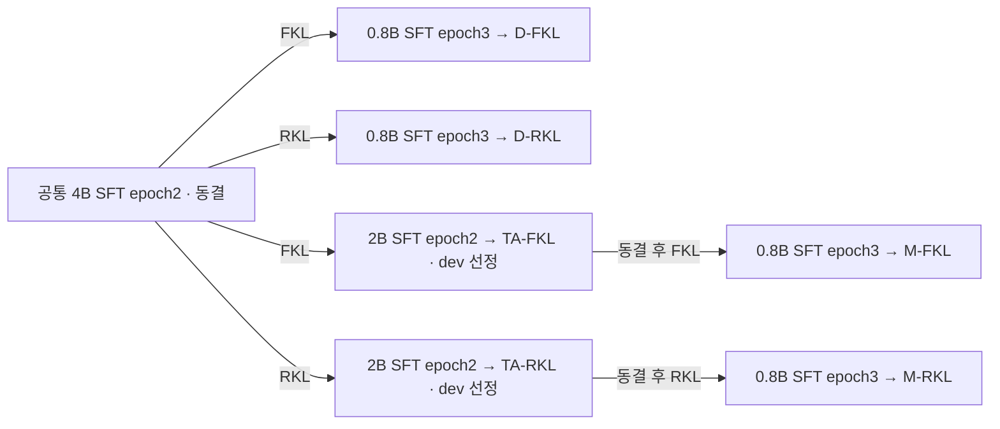

# 실험 흐름과 결과 비교

[문서 안내](README.md) · [방법](RESEARCH_PLAN.md) · [결과·해석](RESEARCH_REPORT.md) · [비교 요약](RESULTS_VISUALIZATION.md)

갱신일: 2026-10-24. 완료된 결과를 도식과 표로 정리했다. 집계 그림과 JSON은 함께 공개하고 HWP·PDF는 로컬에 보존한다.

## 1. 증류 경로

모든 KD 단계는 LR5e-6·3 epoch·1,419 updates·T=1·순수 전체 어휘 KL·동일 사람 설명 prefix다. 최종 학생 네 개의 초기화와 추가 학습 예산이 같으며, 중간 경로의 총 비용은 더 크다. dev로 선정한 각 모델을 동일 test와 256토큰 상한으로 평가한다. [상세 명세](RESEARCH_PLAN.md).

## 2. 다섯 조건의 지표 비교

[최종 논문 표 1](docs/PAPER_KO.md#3-결과)과 같은 수치·열 순서·반올림을 사용한다. 상세 정밀값은 [연구보고서](RESEARCH_REPORT.md#31-최종-08b-다섯-조건)에 보존한다. ACC·Macro-F1은 높을수록, NLL·Brier는 낮을수록 좋다.

| 조건 | NLL | Brier | ACC (%) | Macro-F1 | 상한 (건) |
|---|---:|---:|---:|---:|---:|
| SFT | 1.0422 | 0.5141 | 65.13 | 0.6508 | 0 |
| 직접 FKL | 0.8938 | 0.4707 | 65.18 | 0.6514 | 5 |
| 직접 RKL | 1.1150 | 0.5243 | 65.63 | 0.6561 | 4 |
| 중간 FKL | 0.8675 | 0.4595 | 65.13 | 0.6509 | 5 |
| 중간 RKL | 1.1079 | 0.5201 | 65.22 | 0.6519 | 5 |

설명 상한은 출력 256토큰에 도달하고 EOS로 종료되지 않은 건수다. 상한에 도달해도 유효한 첫 답은 유지했으며 재호출·제외·상한 확대는 하지 않았다. NLL/Brier는 ANSWER 위치의 A–E 조건부 분포이며 설명 사실성 점수가 아니다.

이번 고정 조건의 핵심 결론은 두 경로의 FKL이 SFT와 대응 RKL보다 낮은 NLL·Brier를 기록해 첫 답 A-E 조건부 확률 평가에서 우세했다는 것이다. 직접 FKL의 감소율은 각각 14.24%·8.43%, 중간 FKL은 16.76%·10.62%이며 중간 FKL의 두 점수가 가장 낮았다. 기존 ACC 우선 모델 선정은 그대로이며, 확률 점수 중심의 서술은 사후 해석이다. ACC·혼동 분석은 보조 근거로 사용하고 통계적 유의성이나 내부 표현 개선을 주장하지 않는다.

논문 그림 1은 표의 반올림 전 NLL을 가로축, Brier를 세로축으로 한 다섯 조건의 산점도다. SFT는 회색 ×, 직접 FKL·RKL은 파랑·주황 원, 중간 FKL·RKL은 초록·보라 빈 마름모로 구분하고 범례는 오른쪽 위에 둔다. 점선은 SFT의 각 점수다. 두 축 모두 낮을수록 좋으며 오차막대나 통계적 유의성을 나타내지 않는다. [집계 그림](artifacts/ecqa/kd/figures/ecqa_nll_brier_scatter_paper.png).

### 2.1 중간 FKL−SFT 혼동행렬 차이

논문 그림 2의 각 셀은 **중간 FKL 건수−SFT 건수**다. 행은 정답 A-E, 열은 예측 A-E이며, 다섯 선택지는 의미 범주가 아닌 문항별 선택지 위치다.

| 정답＼예측 | A | B | C | D | E |
|---|---:|---:|---:|---:|---:|
| A | +12 | +1 | -5 | -5 | -3 |
| B | +1 | +2 | +3 | -2 | -4 |
| C | +6 | +4 | +5 | -9 | -6 |
| D | +6 | +1 | +1 | -10 | +2 |
| E | +3 | +3 | +6 | -3 | -9 |

두 조건은 정답 1,429건으로 같고 대각 차이의 합도 0이지만 셀별 구성은 다르다. 모든 행의 합은 0이며 무효 답은 두 조건 모두 0건이다. 빨강·파랑은 각각 건수 증가·감소로 표시했다. 대각의 증가는 정답 증가, 비대각의 증가는 해당 오답 증가이므로 빨강을 일괄적인 개선으로 읽지 않는다. 이 집계 차이는 문항별 예측 전이 행렬이 아니며, NLL·Brier 개선의 원인이나 선택지 위치 편향을 검증하지 않는다. [집계 그림](artifacts/ecqa/kd/figures/ecqa_via_fkl_minus_sft_confusion_paper.png).

두 그림은 저장된 최종 결과에서 CPU로 작성했다. SFT 4B·2B·0.8B 혼동행렬 병렬 그림은 발표용으로 보존한다. 2페이지 논문에서는 토큰 길이 표를 빼고 최종 자료 10,839문항의 입력 129/142/186·기준 응답 62/119/190토큰(중앙값/P95/최대)을 문장으로 적었다.

## 3. 경로 효과와 대응 문항

| 경로 비교 | 중간−직접 ACC (%p) | 공통 정답 | 직접만 정답 | 중간만 정답 | 공통 오답 |
|---|---:|---:|---:|---:|---:|
| FKL | -0.045579 | 1395 | 35 | 34 | 730 |
| RKL | -0.410210 | 1404 | 36 | 27 | 727 |

ΔF=ACC(중간 FKL)−ACC(직접 FKL)=-0.045579%p, ΔR=ACC(중간 RKL)−ACC(직접 RKL)=-0.410210%p, **ΔR−ΔF=-0.364631%p**다. 이는 같은 test 문항의 서술적 차이이며 학습 seed 간 변동을 검증한 결과는 아니다.

이번 고정 조건의 다섯 0.8B 모델 중 직접 RKL의 ACC·Macro-F1이 가장 높았고, 중간 경로는 두 KL 모두 대응 직접 경로보다 ACC가 낮았다. 중간 FKL은 SFT와 정답 수가 같고 중간 RKL은 SFT보다 2건 많았다. FKL은 SFT보다 NLL/Brier가 개선됐지만 RKL은 두 지표가 악화되어 정답률과 확률 품질의 결론을 구분해야 한다.

다음은 상세 기록용 혼동행렬 대각 성분의 변화다. 논문에는 위의 중간 FKL−SFT 전체 차이 그림을 넣고 이 요약표는 생략했다. A–E는 의미 범주가 아닌 선택지 위치이며 위치 편향의 원인 검증을 대신하지 않는다.

| 비교 | A | B | C | D | E | 합계 |
|---|---:|---:|---:|---:|---:|---:|
| 직접 RKL-SFT | +1 | +13 | +6 | -5 | -4 | +11 |
| 중간 FKL-직접 FKL | +14 | -3 | 0 | -4 | -8 | -1 |
| 중간 RKL-직접 RKL | +5 | 0 | -2 | -3 | -9 | -9 |

## 4. 읽을 수 있는 결론과 확인하지 않은 원인

로컬 핵심결과 도식(`output/pdf/ecqa_kd_paper_overview.pdf`)도 같은 결론으로 갱신했다. 상단은 이번 조건의 NLL·Brier에서 FKL 우세를 명시하고, 성능표는 NLL·Brier를 앞에 배치한다. 논문 구성 안내는 그림 1·표 1·그림 2와 일치하며, 기존 ACC 우선 선정 및 사후 해석의 범위를 표시한다.

| 도식·지표 | 관측으로 확인한 결론 | 확정하지 않은 해석 |
|---|---|---|
| 최종 다섯 조건의 ACC·Macro-F1 | 직접 RKL이 가장 높았다. SFT 대비 ACC 이득은 +0.501367%p, 순 정답 11건이다. | 다른 seed·데이터셋에서도 RKL이 우월하다는 주장 |
| 경로 효과 | ΔF=−0.045579%p, ΔR=−0.410210%p, ΔR−ΔF=−0.364631%p다. | 음의 값만으로 통계적으로 유의한 상호작용이나 중간 교사의 일반적 열등함을 확정하는 주장 |
| NLL·Brier | 두 FKL은 SFT보다 개선되고 두 RKL은 악화됐다. 중간 경로는 두 KL 모두 대응 직접 경로보다 점수가 좋았다. | 중간 경로가 모든 지표에서 나쁘다는 주장, NLL·Brier만으로 RKL의 과신이 입증됐다는 주장 |
| 교사→학생의 정오 중첩 | 같은 오답과 교사 오답의 교정이 모두 관측됐다. | 같은 오답의 인과적 계승, 전체 어휘 정보 손실의 직접 측정 |
| 설명 상한 | SFT 0건, KD 4~5건/2,194이며 첫 답은 모두 유효했다. | 잘림이 ACC 차이를 일으켰다는 주장, 설명 내용이 사실적이라는 주장 |
| 경로별 시간 | TA를 포함한 중간 경로의 기록된 비용이 더 크고 ACC 이득은 없었다. | 동일 FLOPs에서의 효율 비교나 모든 교사 재사용 상황의 경제성 평가 |

도식과 표는 seed 10 한 번의 결과다. 오차막대나 유의성을 나타내지 않는다. NLL·Brier는 A–E 조건부 확률 점수이며 설명 사실성·보정 오차만의 지표가 아니다. [관측과 가설의 상세 구분](RESEARCH_REPORT.md)을 함께 읽는다.
