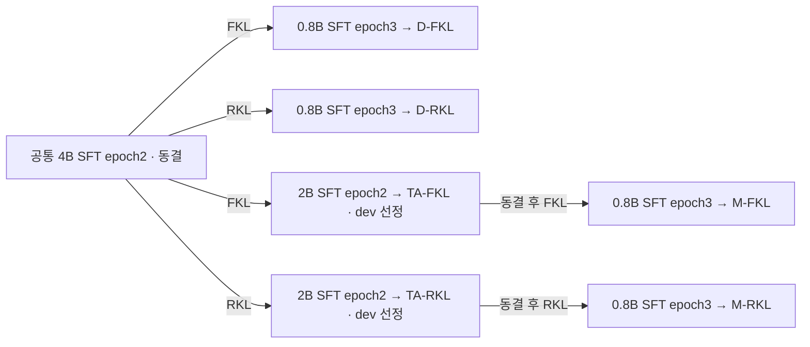

# 실험 흐름과 결과 비교

[문서 안내](README.md) · [방법](RESEARCH_PLAN.md) · [결과·해석](RESEARCH_REPORT.md) · [비교 요약](RESULTS_VISUALIZATION.md)

갱신일: 2026-10-24. 완료된 결과를 도식과 표로 정리했다. 원본 그림 파일과 HWP·PDF는 로컬에 보존하며, 이 문서는 별도 첨부 없이 읽을 수 있다.

## 1. 증류 경로

모든 KD 단계는 LR5e-6·3 epoch·1,419 updates·T=1·순수 전체 어휘 KL·동일 사람 설명 prefix다. 최종 학생 네 개의 초기화와 추가 학습 예산이 같으며, 중간 경로의 총 비용은 더 크다. dev로 선정한 각 모델을 동일 test와 256토큰 상한으로 평가한다. [상세 명세](RESEARCH_PLAN.md).

## 2. 다섯 조건의 지표 비교

[최종 논문 표 1](docs/PAPER_KO.md#3-결과)과 같은 수치·열 순서·반올림을 사용한다. 상세 정밀값은 [연구보고서](RESEARCH_REPORT.md#31-최종-08b-다섯-조건)에 보존한다. ACC·Macro-F1은 높을수록, NLL·Brier는 낮을수록 좋다.

| 조건 | ACC (%) | Macro-F1 | NLL | Brier | 상한 (건) |
|---|---:|---:|---:|---:|---:|
| SFT | 65.13 | 0.6508 | 1.0422 | 0.5141 | 0 |
| 직접 FKL | 65.18 | 0.6514 | 0.8938 | 0.4707 | 5 |
| 직접 RKL | 65.63 | 0.6561 | 1.1150 | 0.5243 | 4 |
| 중간 FKL | 65.13 | 0.6509 | 0.8675 | 0.4595 | 5 |
| 중간 RKL | 65.22 | 0.6519 | 1.1079 | 0.5201 | 5 |

설명 상한은 출력 256토큰에 도달하고 EOS로 종료되지 않은 건수다. 상한에 도달해도 유효한 첫 답은 유지했으며 재호출·제외·상한 확대는 하지 않았다. NLL/Brier는 ANSWER 위치의 A–E 조건부 분포이며 설명 사실성 점수가 아니다.

## 3. 경로 효과와 대응 문항

| 경로 비교 | 중간−직접 ACC (%p) | 공통 정답 | 직접만 정답 | 중간만 정답 | 공통 오답 |
|---|---:|---:|---:|---:|---:|
| FKL | -0.045579 | 1395 | 35 | 34 | 730 |
| RKL | -0.410210 | 1404 | 36 | 27 | 727 |

ΔF=ACC(중간 FKL)−ACC(직접 FKL)=-0.045579%p, ΔR=ACC(중간 RKL)−ACC(직접 RKL)=-0.410210%p, **ΔR−ΔF=-0.364631%p**다. 이는 같은 test 문항의 서술적 차이이며 학습 seed 간 변동을 검증한 결과는 아니다.

이번 고정 조건의 다섯 0.8B 모델 중 직접 RKL의 ACC·Macro-F1이 가장 높았고, 중간 경로는 두 KL 모두 대응 직접 경로보다 ACC가 낮았다. 중간 FKL은 SFT와 정답 수가 같고 중간 RKL은 SFT보다 2건 많았다. FKL은 SFT보다 NLL/Brier가 개선됐지만 RKL은 두 지표가 악화되어 정답률과 확률 품질의 결론을 구분해야 한다.

## 4. 읽을 수 있는 결론과 확인하지 않은 원인

| 도식·지표 | 관측으로 확인한 결론 | 확정하지 않은 해석 |
|---|---|---|
| 최종 다섯 조건의 ACC·Macro-F1 | 직접 RKL이 가장 높았다. SFT 대비 ACC 이득은 +0.501367%p, 순 정답 11건이다. | 다른 seed·데이터셋에서도 RKL이 우월하다는 주장 |
| 경로 효과 | ΔF=−0.045579%p, ΔR=−0.410210%p, ΔR−ΔF=−0.364631%p다. | 음의 값만으로 통계적으로 유의한 상호작용이나 중간 교사의 일반적 열등함을 확정하는 주장 |
| NLL·Brier | 두 FKL은 SFT보다 개선되고 두 RKL은 악화됐다. 중간 경로는 두 KL 모두 대응 직접 경로보다 점수가 좋았다. | 중간 경로가 모든 지표에서 나쁘다는 주장, NLL·Brier만으로 RKL의 과신이 입증됐다는 주장 |
| 교사→학생의 정오 중첩 | 같은 오답과 교사 오답의 교정이 모두 관측됐다. | 같은 오답의 인과적 계승, 전체 어휘 정보 손실의 직접 측정 |
| 설명 상한 | SFT 0건, KD 4~5건/2,194이며 첫 답은 모두 유효했다. | 잘림이 ACC 차이를 일으켰다는 주장, 설명 내용이 사실적이라는 주장 |
| 경로별 시간 | TA를 포함한 중간 경로의 기록된 비용이 더 크고 ACC 이득은 없었다. | 동일 FLOPs에서의 효율 비교나 모든 교사 재사용 상황의 경제성 평가 |

도식과 표는 seed 10 한 번의 결과다. 오차막대나 유의성을 나타내지 않는다. NLL·Brier는 A–E 조건부 확률 점수이며 설명 사실성·보정 오차만의 지표가 아니다. [관측과 가설의 상세 구분](RESEARCH_REPORT.md)을 함께 읽는다.
