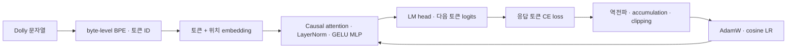

# GPT-2 연구의 인공지능공학 구성

이 문서는 점수와 함께 **어떤 모델이 입력을 어떻게 처리하고, 어떤 손실과 업데이트 규칙으로 학습하는가**를 설명한다. 값은 고정 revision의 모델 config, 실제 tokenizer, [학생 protocol](../results/soft_gate_gradient_v1/student/protocol.json), [공식 소스 manifest](../results/soft_gate_gradient_v1/official_sources.json)와 대조했다. 원문 참조값·로컬 실행값·실제 관측 결과를 구분한다.

## 모델 구조

| 항목 | 학생 GPT-2 base | 교사 GPT-2 XL | 역할 |
|---|---:|---:|---|
| 파라미터 수 | 124,439,808 | 1,557,611,200 | 전체 모델의 학습 가능한 계수 수. 교사는 KD에서 동결 |
| Transformer block | 12 | 48 | 문맥 표현의 반복 갱신 |
| hidden dimension | 768 | 1,600 | 토큰별 내부 표현의 차원 |
| attention head | 12 | 25 | 서로 다른 표현 부분공간의 문맥 결합 |
| head dimension | 64 | 64 | hidden dimension / head 수 |
| MLP 중간 차원 | 3,072 | 6,400 | config의 `n_inner=null`일 때 구현의 `4 × hidden` |
| 최대 position | 1,024 | 1,024 | 모델 구조의 한도. 이번 학습의 입력 길이 512와 구분 |
| 어휘 수 | 50,257 | 50,257 | 공통 토큰 분포의 차원 |
| MLP 활성함수 | `gelu_new` | `gelu_new` | 비선형 특징 변환 |
| LayerNorm epsilon | 1e-5 | 1e-5 | 정규화 분모의 수치 안정성 |
| embedding / attention / residual dropout | 각각 0.1 | 각각 0.1 | 학습 모드에서 확률적으로 일부 신호 차단. 평가 모드에서는 비활성 |

두 모델은 **decoder-only causal Transformer**다. 각 위치는 현재와 앞선 토큰만 참고한다. 토큰 embedding에 학습된 position embedding을 더하고, 각 block의 LayerNorm → masked self-attention → residual, LayerNorm → MLP → residual을 거친다. 마지막 LayerNorm과 LM head가 다음 토큰의 logits를 만든다. 입력 embedding과 출력 LM head의 가중치는 공유한다. 교사의 공식 Dolly-SFT 공개본도 위 XL 구조를 유지한다.



구조의 출처는 고정 [base config](https://huggingface.co/openai-community/gpt2/blob/607a30d783dfa663caf39e06633721c8d4cfcd7e/config.json), [XL config](https://huggingface.co/openai-community/gpt2-xl/blob/15ea56dee5df4983c59b2538573817e1667135e2/config.json), [공식 SFT 교사 config](https://huggingface.co/MiniLLM/teacher-gpt2-1.5B/blob/4a8d07d52ad67b7b87fec9aba25b1521173eb658/config.json)다. 생략된 기본 필드와 MLP 차원은 실제 설치된 Transformers의 config와 GPT-2 구현으로 확인한다. 구조 기본값은 [Transformers GPT-2 문서](https://huggingface.co/docs/transformers/v4.52.2/model_doc/gpt2)에서도 확인할 수 있다.

## 토크나이저와 입력 처리

GPT-2는 **byte-level BPE**로 문자열을 토큰 ID 열로 바꾼다. 단어 단위 분류와 달리 한 단어가 여러 토큰이 될 수 있고, 공백도 표현에 영향을 준다. [공식 tokenizer 설명](https://github.com/huggingface/transformers/blob/main/docs/source/en/tokenizer_summary.md)을 따른다.

로컬 pinned tokenizer의 실제 예는 다음과 같다.

```text
문장: Knowledge distillation helps a small model.
토큰: Know | ledge | Ġdist | illation | Ġhelps | Ġa | Ġsmall | Ġmodel | .
ID:   23812, 2965, 1233, 40903, 5419, 257, 1402, 2746, 13
```

`Ġ` 표기는 이 tokenizer에서 공백을 포함한 토큰 표현이다. 공통 EOS는 `<|endoftext|>` / ID 50256이다. 이번 실행에서는 EOS를 padding ID로도 사용하므로 **ID만 보고 정답과 padding을 구분하지 않고 attention mask와 label mask를 적용**한다. 두 원본 모델의 어휘 일치를 확인했고 공식 SFT 교사도 학습·검증·평가의 전체 준비 record에서 동일한 입력 ID·정답 mask·prompt ID가 나오는지 확인했다. 검증 건수는 [교사 provenance](../results/soft_gate_gradient_v1/teacher.json)에 있다.

Dolly의 instruction과 input으로 공식 프롬프트를 만들고, **prompt + 정답 응답을 이어 붙인 문자열을 한 번에 tokenization한 뒤 EOS를 붙인다.** prompt와 응답을 따로 tokenize해 이어 붙이는 예비 구현과 혼동하지 않는다. prompt는 256토큰 이내, 학습 전체 입력은 512토큰까지 유지한다. prompt와 padding의 label은 `-100`으로 두며 정답 응답의 다음 토큰 예측만 학습한다. 길이 때문에 EOS가 잘린 경우 임의로 끝에 다시 붙이지 않는다.

생성 평가는 prompt를 왼쪽 padding으로 256에 맞추고 전체 길이 512까지 생성한다. 학습 입력의 오른쪽 padding, 모델 구조의 최대 position 1,024와 각각 목적이 다르다.

## 활성함수와 확률 변환

MLP의 `gelu_new`는 다음 tanh 근사 GELU다.

\[
\mathrm{GELU}(x)\approx \tfrac12x\left[1+\tanh\!\left(\sqrt{2/\pi}(x+0.044715x^3)\right)\right].
\]

여기서 `0.044715`는 활성함수 구현의 근사식 계수이며 이번 연구에서 고른 최적값이 아니다. GELU는 내부 표현을 비선형 변환한다. **Softmax**는 attention score나 LM logits를 합이 1인 분포로 바꾸며, GELU와 역할이 다르다. 연구의 **sigmoid gate**는 두 KL 손실의 혼합 비중을 만들고, LM의 활성함수를 대체하지 않는다.

따라서 본 대조에서는 GPT-2의 GELU·LayerNorm·attention 구조를 고정하고, 같은 gate 값에 대해 **gate를 통과하는 추가 gradient만 허용/차단**한다. 교사 동결, 학생의 LM head 동결, `gate.detach()`는 서로 다른 조작이며 이번 핵심 대조는 마지막 항목이다.

## 지도학습 손실과 역전파

정답 응답의 유효 토큰 집합을 \(M\)이라 두면 학생 SFT 손실은 다음과 같다.

\[
L_{\mathrm{SFT}}=-\frac{1}{|M|}\sum_{t\in M}\log q_\theta(y_t\mid x,y_{<t}).
\]

정답 prefix를 입력으로 주는 teacher forcing 방식의 causal language modeling이다. `labels`를 한 위치 이동해 다음 토큰 logits와 대응시키며 prompt·padding은 제외한다. 이번 단일 GPU 구현은 effective batch 전체의 유효 응답 토큰 수로 loss를 나눈다. 길이가 다른 microbatch loss를 단순 평균하면 긴 응답과 짧은 응답의 가중치가 달라지므로 토큰 합과 개수로 누적한다. 이 gradient가 한 번에 처리한 토큰 평균 gradient와 일치하는지 CPU 테스트로 확인했다.

보고할 NLL은 위 음의 로그확률 평균이며 PPL은 `exp(NLL)`이다. 같은 자료·mask·tokenizer에서 낮아진 NLL은 정답 응답에 더 높은 확률을 주었다는 뜻이다. 생성 문장의 사실 정확도나 ROUGE-L과 같은 척도는 아니다.

## 옵티마이저와 스케줄러

학생의 전체 파라미터를 **AdamW**로 업데이트한다. Adam의 gradient 1차·2차 모멘트 추정에 decoupled weight decay를 적용한 방식이다. 원리는 [AdamW 논문](https://arxiv.org/abs/1711.05101), 인자와 업데이트는 [PyTorch AdamW 문서](https://docs.pytorch.org/docs/main/generated/torch.optim.AdamW.html)를 참고한다.

| 항목 | 현재 학생의 설정 | 근거·의미 |
|---|---|---|
| LR 후보 | 5e-4, 1e-4, 5e-5 | MiniLLM 부록 B.1의 소형 모델 탐색 범위. 최적값을 미리 단정하지 않음 |
| effective batch 후보 | 32, 64 | 같은 부록의 후보. optimizer update에 참여하는 record 수 |
| microbatch | 각각 2, 4 | 원문 16-rank 배치 규모를 단일 GPU에서 16회 accumulation으로 대응 |
| betas | (0.9, 0.999) | 공식 코드의 AdamW 기본값. 1차·2차 모멘트의 이동 평균 계수 |
| epsilon | 1e-8 | AdamW 분모의 수치 안정성. LayerNorm epsilon과 구분 |
| weight decay | 0.01 | 공식 SFT 설정. bias와 지정 LayerNorm 계수는 decay 제외 |
| gradient clipping | 전체 norm 1.0 | 공식 SFT 설정. accumulation 후, loss scale을 제거한 뒤 적용 |
| 스케줄러 | cosine, 최소 LR 1e-7 | 공식 cosine 설정·기본 최소 LR. warmup 0 |
| seed | 학습 10 | 공식 SFT 실행기. 생성 5 seed와 구분 |
| SFT 선택 | 6조건 × 20 epoch의 검증 ROUGE-L | 평가 500문항으로 LR·checkpoint를 재선택하지 않음 |
| KD 학생 초기화 | 선택 LR·batch로 새 3 epoch, 최소 검증 loss | SFT 기준선과 별도 학습·별도 목적 |

`5e-4`는 0.0005다. LR은 정규화된 손실의 gradient에 대한 업데이트 크기를 정하며, 1이나 2를 관례적으로 쓰는 항목이 아니다. 위 범위는 선행연구의 탐색 범위이지 모든 상황에서 최적이라는 결론이 아니다. betas·epsilon·clipping 등 고정한 값도 **재현을 위한 기본값**으로 명시하며 검증으로 최적화했다고 표현하지 않는다.

모든 세부값과 원문 이식 차이는 [학생 protocol](../results/soft_gate_gradient_v1/student/protocol.json)에 있다. **공식 교사의 과거 optimizer 탐색 이력까지 직접 검증한 것은 아니다.** 이 절의 직접 실행 설정은 로컬 학생에 해당한다.

## 정밀도와 자원

학생은 FP32 파라미터·Adam 상태, FP16 autocast 연산, GradScaler 초기 scale 2,048 / growth interval 2,000을 사용한다. loss scaling은 작은 gradient의 수치 표현을 보완하며, clipping 전에 scale을 제거한다. TF32는 끈다. gradient checkpointing은 forward 중간값 일부를 backward에서 다시 계산해 activation 메모리를 줄인다. **가중치 양자화나 LoRA 학습과 구분**한다.

원본·SFT 후 생성과 분류는 동일한 FP16 / eager attention 조건으로 비교한다. 교사는 gradient를 계산하지 않는다. 학생 본 학습 전 실제 최대 길이 record의 load → update → 저장 → CPU reload 일치를 확인하고 전용 VRAM peak를 기록한다. 준비 단계의 메모리 추정으로 실측을 대체하지 않는다.

## 공학적 설명과 결과의 연결

결과에는 구조·tokenizer·입력 처리 → 손실·optimizer·scheduler → gradient 흐름 → 검증에 의한 checkpoint 선택 → 생성·분류 평가를 연결한다. 각 단계의 설정 이유, 실제 관측값, 해석 한계를 함께 기록한다. MiniLLM의 단일 GPU 이식 차이는 숨기지 않고, GPT-2에서 핵심 대조를 검증한 뒤 OPT의 구조·tokenizer 차이를 확장 연구에서 다시 점검한다.
