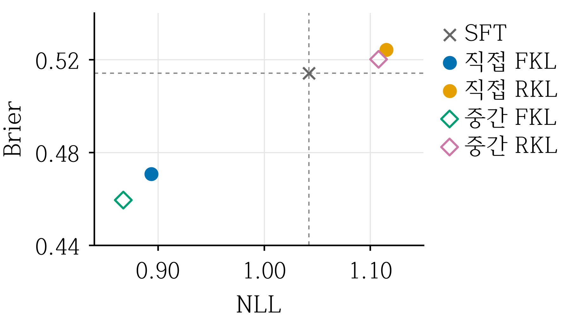
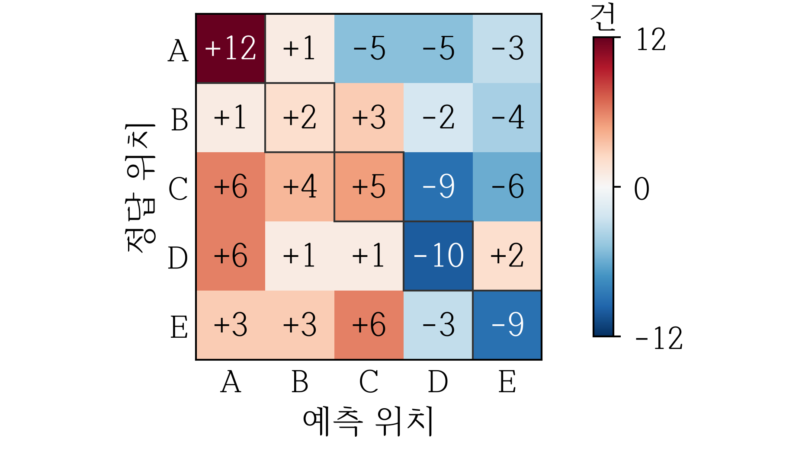

# ECQA에서 증류 경로와 KL 방향에 따른 확률 예측 품질 비교

저자명: [입력 필요]

소속·학과: [입력 필요] / 이메일: [입력 필요]

지도교수: [입력 필요]

## 1. 연구 배경

설명형 상식 질의응답 ECQA[1]에서 중간 교사 방식[2]과 쿨백-라이블러(KL) 발산 방향[3]을 비교한다. 직접·중간 경로와 정방향 KL(FKL)·역방향 KL(RKL)을 교차하고 최종 학생의 초기화·학습량을 통제했다. 확률 점수를 중심으로 해석하고 정확도·혼동 분석을 보조한다.

## 2. 연구 내용

### 2.1 자료와 증류 경로

영문 5지선다 ECQA[1]의 분할 간 ID·정규화 질문 중복을 제거해 학습 7,566·검증 1,079·시험 2,194문항을 고정했다. 학습에는 사람 정답·설명을, 평가에는 질문·선택지만 입력했다.

최종 10,839문항의 입력은 지시문·서식을 포함해 129/142/186토큰, 정답·설명·EOS 응답은 62/119/190토큰이었다(중앙값/P95/최대).

Qwen3.5[4]의 동결 4B 지도 미세조정(SFT) 교사로 직접(4B→0.8B)·중간(4B→2B→0.8B) 경로를 비교했다. 중간·최종 학생은 각각 동일 2B·0.8B SFT의 독립 사본에서 시작했다. 중간 교사는 해당 KL 학습 후 검증 선정·동결했다.

### 2.2 학습 목적과 조건

질문·선택지와 정답·사람 설명의 동일한 접두열을 조건으로, 어휘 v의 교사·학생 확률을 p(v)·q(v)라 하자. 각 응답 위치의 손실은 다음과 같다.

FKL = Σ p(v) log[p(v)/q(v)]

RKL = Σ q(v) log[q(v)/p(v)]

전체 어휘 248,320개를 합산하며 FKL·RKL은 각각 p(v)·q(v)로 가중하고 RKL의 q도 미분했다. 온도 T=1의 순수 KL을 문항별로 종료 토큰(EOS)까지 응답 토큰에 평균했다. 입력·패딩은 제외했으며 log는 자연로그다.

모든 선형층에 저랭크 적응(LoRA)[5] (랭크 r=8·스케일 계수 α=32·드롭아웃 0)을 적용해 각 단계 3회 반복·1,419회 갱신했다. 학습률 5×10⁻⁶·유효 배치 16·시드 10과 AdamW·선형 학습률 감소를 공통으로 적용하고, 단계마다 최적화기·스케줄러를 초기화했다.

### 2.3 모델 선정과 평가

검증 정확도(ACC)→Macro-F1→낮은 정답 음의 로그우도(NLL)→이른 저장 회차 순으로 선정했고 시험 자료는 선정에 쓰지 않았다. 비사고·탐욕·배치 1·상한 256토큰에서 ANSWER→EXPLANATION과 A-E 답을 강제했다. 상한 도달의 유효 답도 채점했다. 확률 점수 강조는 이 ACC 우선 기준을 유지한 사후 해석이다.

Macro-F1은 A-E별 F1의 동일 가중 평균이다. 첫 ANSWER의 A-E 조건부 확률 s(c), 정답 g와 원-핫 y(c)에 대한 문항별 점수는 다음과 같다.

NLL = -log s(g),  Brier = Σ [s(c) - y(c)]²

두 점수는 문항 평균했다. Brier는 A-E에 대해 합산하며 선택지 수로 나누지 않았다[6].

## 3. 결과

두 FKL은 SFT보다 NLL·Brier가 낮았다(그림 1·표 1). 직접 FKL의 감소율은 각각 14.24%·8.43%, 중간 FKL은 16.76%·10.62%였다. 중간 FKL이 두 점수에서 가장 낮았다.

그림 1. NLL·Brier 비교. 점선은 SFT 기준이다.

표 1. 0.8B 모델의 시험 성능 (2,194문항)

| 조건 | NLL | Brier | ACC (%) | Macro-F1 | 상한 (건) |
|---|---:|---:|---:|---:|---:|
| SFT | 1.0422 | 0.5141 | 65.13 | 0.6508 | 0 |
| 직접 FKL | 0.8938 | 0.4707 | 65.18 | 0.6514 | 5 |
| 직접 RKL | 1.1150 | 0.5243 | 65.63 | 0.6561 | 4 |
| 중간 FKL | 0.8675 | 0.4595 | 65.13 | 0.6509 | 5 |
| 중간 RKL | 1.1079 | 0.5201 | 65.22 | 0.6519 | 5 |

상한: EOS 없이 256토큰에 도달한 문항 수. NLL·Brier는 낮을수록 좋다.

중간 FKL과 SFT는 정답 1,429건으로 같지만 혼동행렬 구성은 달랐다(그림 2). A-E는 선택지 위치이며 양수·음수는 각 셀의 문항 수 증가·감소다. 직접 RKL은 SFT보다 11건 더 맞혔지만 NLL·Brier는 높았다.

그림 2. 중간 FKL-SFT 혼동행렬 차이(건).

ΔF·ΔR은 각 KL의 중간-직접 ACC 차이로 -0.0456%p·-0.4102%p이며 ΔR-ΔF=-0.3646%p다. 반올림 전 값으로 구한 서술적 차이다.

## 4. 논의

정답 수가 같아도 각 선택지에 부여한 확률이 달라지면 NLL·Brier는 달라질 수 있다[6]. 중간 FKL은 SFT와 정답 수가 같아도 두 확률 점수가 낮아진 사례로, 정확도만으로 드러나지 않는 차이를 보여준다. 혼동행렬은 선택지 위치별 집계 차이를 보충하며 문항별 전이를 나타내지는 않는다.

교사 크기·정확도·분포·학습 이력이 함께 달라져 경로 차이의 원인별 효과는 분리할 수 없다. 정보 손실·오류 잔존과 RKL의 분포 집중에 따른 설명은 미검증 가설이다. 응답 전체 학습·첫 답 평가의 차이와 ACC 우선 선정의 영향도 분리해 검증하지 않았다.

단일 시드·모델 계열·자료와 제한된 출력 형식의 결과로 통계적 유의성과 일반화 가능성은 검증하지 않았다. 동일 추가 학습량의 교차엔트로피(CE) 대조군이 없어 추가 학습과 KL 고유 효과를 분리하지 못했으며 중간 경로에는 2B 학습 비용이 추가된다. 내부 표현·확률 보정의 개선과 설명 사실성·사전학습 자료 노출은 검토하지 않았다.

## 5. 결론 및 향후 계획

이번 고정 조건에서는 두 경로 모두 FKL이 SFT와 대응 RKL보다 낮은 NLL·Brier를 기록해 첫 답의 A-E 조건부 확률 평가에서 우세했다. 특히 중간 FKL의 NLL·Brier는 SFT 대비 각각 16.76%·10.62% 감소했으며 다섯 조건 중 가장 낮았다. 대응 직접 경로 대비 중간 경로의 ACC 개선은 관측되지 않았으며, 경로 효과의 해석은 평가 지표에 따라 달랐다.

향후에는 여러 시드·자료와 동일 추가 학습량의 CE 대조군으로 검증하고 문항별 확률·설명 사실성·총비용을 분석할 계획이다.

## 참고문헌

[1] S. Aggarwal et al., “Explanations for CommonsenseQA: New Dataset and Models,” ACL-IJCNLP, pp. 3050-3065, 2021. https://aclanthology.org/2021.acl-long.238/

[2] S.-I. Mirzadeh et al., “Improved Knowledge Distillation via Teacher Assistant,” AAAI, 2020. https://arxiv.org/abs/1902.03393

[3] Y. Gu et al., “MiniLLM: Knowledge Distillation of Large Language Models,” ICLR, 2024. https://arxiv.org/abs/2306.08543v4

[4] Qwen Team, “Qwen3.5: Towards Native Multimodal Agents,” 2026. https://qwen.ai/blog?id=qwen3.5

[5] E. J. Hu et al., “LoRA: Low-Rank Adaptation of Large Language Models,” arXiv:2106.09685, 2021. https://arxiv.org/abs/2106.09685

[6] T. Gneiting and A. E. Raftery, “Strictly Proper Scoring Rules, Prediction, and Estimation,” JASA, vol. 102, no. 477, pp. 359-378, 2007. https://doi.org/10.1198/016214506000001437
