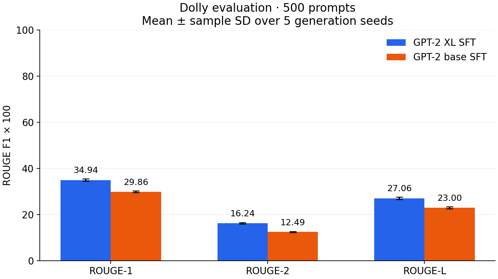
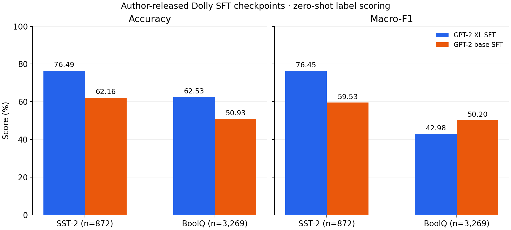

# 두 생성 모델의 SFT 기준선 평가

기준일: 2026-10-15, Asia/Seoul. **MiniLLM 저자의 SFT 완료 체크포인트를 현재 GPU에서 평가한다. 이번 작업에서 SFT 학습을 새로 수행한 것은 아니다.**

## 평가 대상과 해석 범위

| 역할 | 체크포인트 | 고정 revision | 공개된 학습 상태 |
|---|---|---|---|
| XL | [MiniLLM/teacher-gpt2-1.5B](https://huggingface.co/MiniLLM/teacher-gpt2-1.5B) | `4a8d07d52ad67b7b87fec9aba25b1521173eb658` | GPT-2 XL을 Dolly로 SFT한 교사 |
| base | [MiniLLM/SFT-gpt2-120M](https://huggingface.co/MiniLLM/SFT-gpt2-120M) | `b9d32f7ca7e06832c7fe9e8211b53c732fbae5b4` | GPT-2 base의 SFT 비교 기준선 |

[공식 README §5.1](https://github.com/microsoft/LMOps/blob/48fca1acc61ffa20ebb7c31c74a1d8e33499b476/minillm/README.md#51-baselines)과 모델 카드를 근거로 선정했다. base의 최종 SFT baseline과 MiniLLM 시작용 `init-gpt2-120M`은 구분한다. 두 SFT 모델의 어휘 ID 전체와 tokenizer backend 일치를 확인했다. 이전 기반 모델의 짧은 추론 점검과 이번 SFT 모델의 성능 평가는 서로 다른 실행이다.

이 평가는 **선정한 두 공개 SFT 체크포인트의 현재 수행**을 보여 준다. SFT 전후의 개선 효과, 직접 재학습의 재현성, KD의 효과를 입증하는 비교는 아니다. 두 모델의 전체 학습 이력·사전학습 오염을 독립 감사한 것은 아니다. 원문은 모델 크기에 따라 학습 epoch와 학습률 탐색 조건을 달리하므로, 두 공개 체크포인트의 차이를 파라미터 수 하나의 인과 효과로 해석하지 않는다.

## 데이터와 사전 점검

정확한 revision·파일 SHA256·행 수는 [교사 protocol](../results/sft_baselines/teacher_protocol.json)과 [학생 protocol](../results/sft_baselines/student_protocol.json)에 남긴다. 일부를 임의 표집하지 않고 다음 공개 집합을 사용한다.

| 집합 | 원본 규모 | 역할·처리 |
|---|---:|---|
| MiniLLM/dolly `valid.jsonl` | 500 | 공개 평가 코드가 읽는 Dolly 생성 평가 자료. 기존 prompt와 topic을 보존 |
| stanfordnlp/sst2 validation | 872 | sentiment의 negative/positive 정답으로 분류 평가 |
| super_glue/boolq validation | 3,270 | passage·question과 No/Yes 정답으로 분류 평가. native context 1,024 토큰을 초과하면 잘라내지 않고 제외 ID와 수를 보고 |

[공식 평가 코드](https://github.com/microsoft/LMOps/blob/48fca1acc61ffa20ebb7c31c74a1d8e33499b476/minillm/evaluate_main.py)가 `valid.jsonl`을 test 역할로 읽는 것을 확인했다. 파일 이름만 보고 새 validation/test 분할을 만든 것은 아니다. 이는 공개 체크포인트 평가용 집합이며 우리의 향후 연구에서 독립된 최종 test로 자동 재사용하지 않는다.

Dolly의 `raw.jsonl` 12,435행과 비교했을 때 **공백·대소문자를 정규화한 instruction+input 9종이 평가 10문항과 일치**했다. 전체 500문항 결과와 해당 10문항을 제외한 490문항 결과를 함께 남긴다. 제외 기준은 모델 출력 확인 전에 정했다. 완전한 학습 membership이나 의미상 중복을 검사한 것은 아니므로 나머지를 누수 없는 집합이라고 단정하지 않는다.

## 지표를 읽는 방법

| 대상 | 지표 | 의미와 한계 |
|---|---|---|
| SST-2·BoolQ | accuracy | 두 label 중 고른 답의 정답 비율. 자유 생성의 지시 준수 점수와 다름 |
| SST-2·BoolQ | macro-F1, 클래스별 precision/recall/F1 | 각 클래스 F1의 단순 평균과 오류 방향. 한쪽 label 편향 확인 |
| SST-2·BoolQ | balanced accuracy, weighted-F1, MCC | 클래스 불균형과 예측·정답의 대응을 추가 진단 |
| SST-2·BoolQ | 혼동행렬·majority baseline | 실제 정답을 행, 예측을 열로 기록. 가장 많은 클래스만 고르는 기준선과 대조 |
| SST-2·BoolQ | positive-class Brier·원래 label 확률질량 | 두 label에 조건부로 정규화한 확률의 오차. 어휘 전체에서 두 label이 차지하는 확률질량도 보고. 전체 생성 확률의 calibration으로 해석하지 않음 |
| Dolly | ROUGE-1/2/L, word-overlap F1, 정규화 Exact Match | reference와의 어휘·순서 일치. 사실성·창작 품질·정답률의 대체값이 아님 |
| Dolly | reference token NLL·perplexity·token accuracy | reference prefix를 주었을 때 다음 응답 토큰을 예측. 자유 생성 accuracy와 구분 |
| Dolly | 길이·빈 응답·길이 상한 도달·Distinct-4 | 출력 형태와 반복 진단. 높거나 낮다는 사실만으로 품질 우열을 정하지 않음 |

macro-F1은 SST-2·BoolQ의 정해진 label에서 계산한다. 서로 다른 자유 생성 응답을 임의 클래스로 만들어 Dolly 전체의 macro-F1을 계산하지 않는다. Dolly의 word-overlap F1은 문항별 단어 multiset의 겹침이며 **분류 macro-F1과 다른 지표**다. Exact Match의 정규화는 공식 코드와 같이 소문자·ASCII 구두점 제거·공백 정리를 사용하고 관사는 제거하지 않는다. ROUGE는 stemming을 사용한다.

분류 prompt는 [MiniLLM v4 Appendix B.2, Figure 11–12](https://arxiv.org/html/2306.08543v4)를 따른다. 두 label은 이 tokenizer에서 각각 단일 토큰임을 검증하고 해당 logits의 argmax로 답을 정한다. 동률이면 class 0을 선택한다. BoolQ의 label 0/1은 No/Yes다. 질문 뒤 물음표를 정리해 하나만 붙인다. **원문 분류 표는 LLaMA 기반이므로 이번 GPT-2 결과를 그 표의 재현으로 표시하지 않는다.**

## 생성·추론 protocol

float16·eager attention·eval·gradient 비활성 상태에서 평가한다. 처음 XL을 실행한 뒤 메모리 범위를 확인해 base를 별도 프로세스에서 병행했다. 모델별 GPU allocator peak는 해당 프로세스의 값이며, 경과 시간은 단독 실행의 속도 비교 자료가 아니다. 양자화·LoRA·별도 보정 학습은 적용하지 않는다. 다음 값은 새 최적값이 아니라 **고정한 원문·공식 코드의 평가 설정**이다.

- [Appendix B.2](https://arxiv.org/html/2306.08543v4): sampling temperature=1, seed 10/20/30/40/50. 다섯 번은 생성 반복이며 독립 학습 반복이 아니다.
- [Dolly 평가 script](https://github.com/microsoft/LMOps/blob/48fca1acc61ffa20ebb7c31c74a1d8e33499b476/minillm/scripts/gpt2/eval/eval_main_dolly.sh)·[실행 script](https://github.com/microsoft/LMOps/blob/48fca1acc61ffa20ebb7c31c74a1d8e33499b476/minillm/scripts/gpt2/eval/run_eval.sh): 왼쪽 padding prompt 256, 총 길이 512에 따라 생성 상한 256, batch 8, top-k=0, top-p=1.
- [generation 인자 기본값](https://github.com/microsoft/LMOps/blob/48fca1acc61ffa20ebb7c31c74a1d8e33499b476/minillm/arguments.py): no-repeat-ngram-size=6. 따라서 반복 진단은 **반복 억제가 있는 이 decoding 조건**의 관측이다.
- Dolly 공개 500개 prompt는 모두 256토큰 이하임을 확인했다. reference 진단은 [공식 loader](https://github.com/microsoft/LMOps/blob/48fca1acc61ffa20ebb7c31c74a1d8e33499b476/minillm/data_utils/prompt_datasets.py)의 상한에 맞춰 첫 256개 응답 토큰까지 계산하고 잘린 reference 수를 기록한다. EOS·prompt·padding은 reference token 지표에서 제외한다.

ROUGE와 정규화 Exact Match는 공식 metric과 연결한다. 추가 지표의 정의·집계는 [평가 코드](../scripts/evaluate_sft_baselines.py)에 있다. Distinct-4는 이 구현에서 공백으로 나눈 응답 단어의 corpus 4-gram 고유 비율이다. token NLL·perplexity는 응답 토큰으로 가중하고 mean-example NLL도 별도 기록한다. 일부 구현·라이브러리·GPU가 달라 원문 숫자와 비트 단위 동일성을 보장하지 않는다.

## 결과

### 분류 평가

분류 평가는 완료했다. 아래 점수는 0–100 척도이며 SST-2 n=872, BoolQ n=3,269다. BoolQ 제외 ID는 3154다.

| 데이터 | SFT 모델 | Accuracy | Macro-F1 | Balanced accuracy | Weighted-F1 |
|---|---|---:|---:|---:|---:|
| SST-2 | GPT-2 XL | 76.49 | 76.45 | 76.44 | 76.47 |
| SST-2 | GPT-2 base | 62.16 | 59.53 | 61.71 | 59.72 |
| BoolQ | GPT-2 XL | 62.53 | 42.98 | 51.32 | 51.10 |
| BoolQ | GPT-2 base | 50.93 | 50.20 | 51.00 | 51.67 |

BoolQ에서는 XL의 accuracy가 높지만 macro-F1은 base가 높다. XL의 No recall은 5.25%, Yes recall은 97.39%로 한쪽 label에 치우쳤다. 해당 집합의 majority-class accuracy는 62.16%이며 XL의 62.53%와 함께 읽어야 한다. 이 관측을 Dolly 생성의 성능이나 증류 효과로 확대하지 않는다.

SST-2에서 지정한 두 label의 원래 확률질량 합은 평균 XL 83.99%, base 10.26%였다. 정해진 label 사이의 선택 정확도와 자유 생성의 label 형식 준수는 다르다. 사후에 다른 verbalizer를 골라 같은 자료의 점수를 최적화하지 않았다.

### Dolly 생성 평가

두 모델 모두 500문항 × 5개 seed 평가를 완료했다. 아래 ±는 **생성 seed 사이의 표본 표준편차**이며 독립 SFT 학습의 변동이나 신뢰구간이 아니다.



| 지표 | GPT-2 XL SFT | GPT-2 base SFT |
|---|---:|---:|
| ROUGE-1 × 100 | 34.94 ± 0.50 | 29.86 ± 0.38 |
| ROUGE-2 × 100 | 16.24 ± 0.33 | 12.49 ± 0.23 |
| ROUGE-L × 100 | 27.06 ± 0.48 | 23.00 ± 0.41 |
| 단어 겹침 F1 × 100 | 33.36 ± 0.43 | 28.55 ± 0.46 |
| 정규화 Exact Match (%) | 2.80 ± 0.37 | 2.00 ± 0.20 |
| 평균 생성 토큰 수 | 58.64 ± 1.32 | 59.30 ± 0.81 |
| 생성 상한 도달 (%) | 1.32 ± 0.27 | 1.72 ± 0.48 |
| 빈 응답 (%) | 0.00 ± 0.00 | 0.00 ± 0.00 |
| Distinct-4 (%) | 98.14 ± 0.22 | 97.86 ± 0.18 |
| Reference token NLL ↓ | 3.72 | 5.08 |
| Reference token perplexity ↓ | 41.12 | 161.50 |
| Reference token accuracy (%) | 49.87 | 41.02 |

reference 진단은 두 모델 모두 같은 **38,775개 응답 토큰**에서 계산했다. 500개 reference 중 34개는 첫 256토큰까지만 읽었고 EOS는 제외했다. token accuracy는 reference prefix를 준 진단이며 자유 생성의 정답률이 아니다.

### 입력 중복 표시 문항을 제외한 비교

| 집계 | XL ROUGE-L × 100 | base ROUGE-L × 100 |
|---|---:|---:|
| 공개 500문항 전체 | 27.06 ± 0.48 | 23.00 ± 0.41 |
| 중복 표시 10행 제외: 490문항 | 26.84 ± 0.49 | 22.99 ± 0.42 |

490문항을 완전히 누수 없는 집합으로 부르지 않는다. 모델 출력에 따른 선별은 하지 않았다.

### 과제별 ROUGE-L

같은 500문항을 topic별로 나눈 5개 생성 seed 평균이며 0–100 척도다. 과제별 reference 일치 점수이지 모든 과제의 실제 정답률이 아니다.

| Topic | 문항 수 | XL | base |
|---|---:|---:|---:|
| closed_qa | 36 | 35.04 | 31.85 |
| classification | 73 | 51.11 | 46.65 |
| open_qa | 141 | 22.10 | 17.06 |
| brainstorming | 71 | 19.53 | 16.30 |
| information_extraction | 27 | 37.29 | 30.68 |
| general_qa | 99 | 16.46 | 14.77 |
| summarization | 28 | 34.27 | 26.62 |
| creative_writing | 25 | 17.52 | 14.00 |

### 여기서 읽을 수 있는 것

이 조건의 Dolly 생성에서는 XL의 ROUGE-L이 base보다 약 4.06점 높고 reference NLL도 낮다. BoolQ의 accuracy·macro-F1은 서로 다른 순위를 보이므로 하나의 점수로 모든 과제의 교사 적합성을 정하지 않는다. SFT 전후나 KD 효과를 비교한 결과는 아니며, 다른 prompt·verbalizer를 사후 선택해 점수를 높이지 않았다.



원자료 집계: [분류 CSV](../results/sft_baselines/classification.csv)·[Dolly CSV](../results/sft_baselines/dolly.csv)·[XL 전체 기록](../results/sft_baselines/teacher.json)·[base 전체 기록](../results/sft_baselines/student.json). CSV/JSON의 비율 지표는 기본 0–1 척도이며 위 표·그림은 해당 지표를 ×100으로 표시한다. MCC는 −1~1, NLL은 응답 토큰당 nats다. 전체 환경은 [환경 기록](../results/sft_baselines/environment.json)을 따른다.

## 실행과 원자료

기존 PyTorch/Transformers 환경은 [기반 모델 점검 기록](../results/model_preflight.json)을 따르며 추가 의존성은 [requirements-eval.txt](../requirements-eval.txt)에 고정했다. 현재 추가 의존성은 전역 Python을 바꾸지 않고 Git 제외 `tmp/eval_deps/`에 설치했다.

```powershell
python -m pip install --target tmp/eval_deps -r requirements-eval.txt
python scripts/evaluate_sft_baselines.py --self-test
python scripts/evaluate_sft_baselines.py
python scripts/report_sft_baselines.py
python scripts/summarize_dolly.py
```

완료된 seed 결과는 실행 fingerprint가 같은 경우만 재사용하며, 불완전한 seed는 같은 seed 처음부터 다시 계산한다. 다른 코드의 완료 파일이 있으면 덮어쓰지 않고 중단하므로 재평가 전 기존 결과를 별도 보관해야 한다. 가중치·입력 자료·문항별 응답·분류 확률은 로컬 `tmp/`에 보관한다. 공개 저장소에는 코드·protocol·집계만 남긴다. `*_progress.json`은 실행 중 상태이며 최종 평가 완료 파일과 구분한다.

학생의 공개 safetensors는 공유 embedding을 `lm_head.weight` 이름으로 저장했다. 현재 Transformers의 meta 로딩에서 오류가 발생해 학생은 CPU에서 모델을 구성하고 `safetensors.load_model(strict=True)`로 공유 가중치를 읽은 뒤 GPU로 옮겼다. 모든 저장 tensor가 float16 변환값과 정확히 일치하고, 입력 embedding과 공유된 head가 저장값과 일치하는지 assert로 확인했다. 원본 가중치 파일은 변경하지 않았다.

교사는 로더 수정 전 [코드 commit 9746565](https://github.com/distillguard/knowledge-distillation-ai-engineering/blob/9746565/scripts/evaluate_sft_baselines.py), 학생은 [로더 수정 코드 commit aa7da33](https://github.com/distillguard/knowledge-distillation-ai-engineering/blob/aa7da33/scripts/evaluate_sft_baselines.py)를 실행했다. 각 protocol의 코드 hash와 seed fingerprint를 보존하며, 집계 코드는 두 실행의 데이터·generation·정밀도 설정이 같음을 검사한다. 변경은 학생의 저장 가중치를 읽는 경로와 실행 기록이며 지표·prompt·sampling 정의는 바꾸지 않았다.

현재 실행기에는 다른 fingerprint의 완료 결과를 새 protocol로 덮어쓰기 전에 중단하는 보호 검사를 추가했다. 이 검사는 기존 JSON 파일들의 hash가 실행 전후 그대로인지 확인했다. 측정에 사용한 두 코드 버전과 결과는 위 링크·각 protocol로 보존한다.
