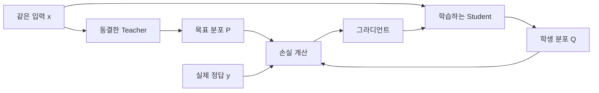

# 신경망의 지식 증류 — Hinton 외, 2015

원제: *Distilling the Knowledge in a Neural Network*

저자: Geoffrey Hinton, Oriol Vinyals, Jeff Dean

기준: [arXiv:1503.02531v1](https://arxiv.org/abs/1503.02531v1), 2015-03-09

읽을 원문: [PDF](https://arxiv.org/pdf/1503.02531v1)

**문서 종류:** 한국어 해설과 수식 풀이. 원문 전문 번역이 아니다. 확인한 원문의 [arXiv 배포 라이선스](https://arxiv.org/licenses/nonexclusive-distrib/1.0/license.html)를 번역 재배포 허가로 간주하지 않았다. 원문 요지는 짧게 정리하고, 나머지는 직접 작성한 학습 예시·수학적 풀이·읽기 질문으로 구성했다.

## 1. 이 논문에서 먼저 붙잡을 질문

**모델이 배운 지식은 정답 하나에만 들어 있는가, 입력에 따른 예측분포에도 들어 있는가?**

[원문 요지] 저자들은 학습과 배포의 자원 요구가 다르다는 문제에서 출발한다. 큰 모델이나 앙상블의 예측분포를 학습 목표로 사용해 배포하기 쉬운 모델에 정보를 전달한다. 정답 외 후보의 상대적인 확률에도 유용한 구조가 있을 수 있으며, 온도로 작은 확률의 영향을 키운다. 정답 라벨이 있으면 별도의 지도 손실도 결합한다. 근거는 MNIST와 음성 인식 실험이며, JFT의 specialist 모델과 soft target의 정규화 효과도 다룬다.

[해설] 따라서 첫 독해 목표는 “큰 모델을 작게 만든다”라는 문장을 외우는 것이 아니다. **어떤 입력에서 어떤 출력 정보가 학생의 학습 목표가 되는지**를 설명하는 것이다.

## 2. 원문을 읽는 지도

| 원문 위치 | 읽을 대상 |
|---|---|
| §1 | 지식의 표현과 배포 문제 |
| §2 | soft target, 온도, 정답 손실 |
| §2.1 식 (2)–(4) | 그라디언트와 높은 온도 근사 |
| §3 | MNIST 실험 |
| §4·Table 1 | 음성 인식과 앙상블 전달 |
| §5 | JFT specialist 구성 |
| §6·Table 5 | soft target과 일반화 |
| §7–8 | experts와의 관계, 결론의 범위 |

한 번에 모두 읽지 않는다. §2 식 (2)를 설명할 수 있게 된 다음 실험으로 넘어간다.

## 3. 한 문제에서 학생은 어떤 신호를 받는가?

[학습용 예시] 후보가 고양이·개·자동차인 분류 문제를 생각하자. 아래 숫자는 설명용이며 논문 실측값이 아니다.

| 정보 | 고양이 | 개 | 자동차 |
|---|---:|---:|---:|
| 실제 정답인 hard target | 1 | 0 | 0 |
| 교사의 soft target P | 0.80 | 0.15 | 0.05 |
| 현재 학생의 예측 Q | 0.40 | 0.35 | 0.25 |

hard target은 정답에 집중하도록 한다. soft target은 교사가 후보 전체에 배정한 비율을 따라가도록 한다. 여기서 개의 15%는 “실제 정답이 15%만큼 개”라는 라벨이 아니다. 교사의 출력 정보다.

학습에 쓰는 대상은 모델 가중치 복사본이 아니라 **입력 x에 조건부인 분포 P(·|x)**다. 교사와 학생의 분포를 비교하려면 각 좌표가 같은 후보를 뜻해야 한다.

이 그림은 읽기를 위한 기본 흐름이다. 모든 증류 방법이 실제 정답 y를 반드시 사용한다는 뜻은 아니다.

## 4. softmax와 온도 T

[수학 풀이] 교사의 logits를 v, 학생의 logits를 z라고 하자.

$$
P_i^{(T)}=\frac{\exp(v_i/T)}{\sum_j\exp(v_j/T)},\qquad
Q_i^{(T)}=\frac{\exp(z_i/T)}{\sum_j\exp(z_j/T)}.
$$

T가 커지면 같은 logit 차이가 확률에 미치는 영향이 작아진다. 양수 T로 나누면 logit 순서는 유지되므로, 고정된 logits의 최고 확률 후보는 바뀌지 않는다. 파라미터 수나 모델의 표현 능력이 늘어나는 것도 아니다.

T=1의 확률 P를 알고 있다면 같은 logits에서 온도를 바꾼 확률은 다음과 같이 구할 수 있다.

$$
P_i^{(T)}=\frac{P_i^{1/T}}{\sum_jP_j^{1/T}}.
$$

[학습용 예시] P=[0.80,0.15,0.05]에 T=2를 적용하면 약 [0.594,0.257,0.149]다. 교사의 원래 후보 관계가 더 눈에 띄게 되지만, 그 관계가 실제로 유용한지는 별도 문제다. T는 교사의 오류를 판별하는 장치가 아니다.

**확인 질문:** T를 바꾸는 순간 바뀌는 것은 logits의 순서인가, 확률 차이인가?

## 5. CE와 Forward KL의 연결

학생이 정답 y에 높은 확률을 주게 만드는 손실은

$$
L_{\mathrm{hard}}=-\log Q_y^{(1)}
$$

이며 교사의 분포를 목표로 하는 soft CE는

$$
L_{\mathrm{soft}}=-\sum_iP_i^{(T)}\log Q_i^{(T)}
$$

다. Forward KL을 전개하면

$$
D_F=\sum_iP_i\log\frac{P_i}{Q_i}
=\underbrace{-\sum_iP_i\log Q_i}_{CE(P,Q)}
-\underbrace{\left(-\sum_iP_i\log P_i\right)}_{H(P)}.
$$

동결한 교사와 고정된 T에서는 H(P)가 학생 파라미터와 무관하다. 따라서 이 조건의 soft CE와 Forward KL은 학생에게 같은 그라디언트를 준다. 손실의 숫자까지 같다는 뜻은 아니다.

## 6. 원문 식 (2)를 직접 유도하기

[독립 풀이] P는 고정된 목표이고 합이 1이라고 하자. softmax의 로그를 손실에 대입하면

$$
L=-\sum_iP_i\left(\frac{z_i}{T}-\log\sum_j e^{z_j/T}\right)
=-\frac1T\sum_iP_i z_i+\log\sum_j e^{z_j/T}.
$$

z_k로 미분하면

$$
\frac{\partial L}{\partial z_k}
=-\frac{P_k}{T}+\frac{Q_k}{T}
=\frac{Q_k-P_k}{T}.
$$

그라디언트 하강은 이 값의 반대 방향으로 움직인다. 학생 확률이 목표보다 작은 좌표는 logit를 올리는 신호를 받는다.

[학습용 예시, T=1]

| 후보 | soft CE의 ∂L/∂z | hard CE의 ∂L/∂z |
|---|---:|---:|
| 고양이 | −0.40 | −0.60 |
| 개 | +0.20 | +0.35 |
| 자동차 | +0.20 | +0.25 |

둘 다 고양이 쪽으로 움직이지만, 다른 후보를 내리는 상대적인 신호가 다르다. 실제 네트워크에서는 이 logit 그라디언트에 네트워크의 Jacobian이 곱해져 파라미터 그라디언트가 된다. 위 표를 파라미터의 직접 변화량으로 읽지 않는다.

**확인 질문:** 손실이 작아진다는 것과 새 문제의 정답률이 높아진다는 것은 왜 같은 명제가 아닌가?

## 7. 높은 T 근사와 T²

[수학 풀이] 후보 수가 N이고 각 입력에서 logits의 평균을 0으로 맞췄다고 하자. |z_i|/T와 |v_i|/T가 충분히 작으면 e^a≈1+a를 사용할 수 있다.

$$
Q_i^{(T)}\approx\frac1N+\frac{z_i}{NT},\qquad
P_i^{(T)}\approx\frac1N+\frac{v_i}{NT}.
$$

따라서

$$
\frac{\partial L}{\partial z_i}
\approx\frac{z_i-v_i}{NT^2}.
$$

이 근사에서 soft loss에 T²를 곱하면 온도 증가로 줄어든 그라디언트 크기를 대략 보정한다. **모든 T에서 정확히 동일한 학습 신호를 만든다는 보장은 없다.**

softmax는 모든 logit에 같은 상수를 더해도 바뀌지 않는다. 그래서 분포를 맞춘다는 것과 중심을 맞추지 않은 raw logits를 그대로 맞춘다는 것을 구분해야 한다.

## 8. 정답과 교사의 목표를 함께 쓰기

[해설용 표기]

$$
L=\alpha T^2L_{\mathrm{soft}}+(1-\alpha)L_{\mathrm{hard}}.
$$

이 α 표기는 이해를 위한 현대적인 표현이다. 원문의 표기와 그대로 같은 기호라고 생각하지 않는다.

| 요소 | 결정하는 것 |
|---|---|
| T | 비교할 확률분포 |
| α | 두 목표의 상대 비중 |
| 그라디언트 | 현재 상태에서 손실을 바꾸는 방향 |
| 옵티마이저·학습률 | 그 신호를 실제 갱신에 사용하는 방법과 크기 |

[학습용 예시] 실제 정답이 고양이인데 교사가 [0.10,0.85,0.05]를 출력하면 soft CE는 개 쪽으로 학습시키고 hard CE는 고양이 쪽으로 학습시킨다. 교사를 더 잘 모방하는 것과 정답을 더 잘 맞히는 것이 충돌할 수 있다. 일반적인 옵티마이저가 어느 목표가 사실인지 판별해 주지는 않는다.

## 9. 실험 근거를 읽는 최소 기록

[원문 수치, §3·§4·§6] MNIST test 오류 수는 큰 모델 67, 보통 학습한 작은 모델 146, 증류한 작은 모델 74다. 음성 인식 Table 1의 frame accuracy는 baseline 58.9%, 앙상블 61.1%, 증류 모델 60.8%다. Table 5의 test frame accuracy는 전체 데이터 hard 학습 58.9%, 3% 데이터 hard 학습 44.5%, 3% 데이터 soft 학습 57.0%다. soft target을 만든 교사는 전체 데이터를 사용했다.

[원문 주장 범위] 출력분포를 통한 전달과 해당 실험의 일반화 이점을 보여준다. §8은 specialist 지식을 단일 모델로 다시 증류하는 결과를 아직 보여주지 않았다고 명시한다.

[해설] 모델 크기, 학습 데이터, 전달 데이터, 배포 비용을 서로 다른 열로 기록해야 결과를 제대로 읽을 수 있다. 학생의 전달 단계가 적은 데이터를 사용했다고 해서 교사 학습까지 포함한 전체 과정이 같은 양의 데이터만 사용했다고 결론내릴 수는 없다.

## 10. 분석하면서 남길 질문

1. 분포의 어떤 차이를 줄이는 것이 실제 과제 수행에 도움이 되는가?
2. 정답 외 후보 사이의 관계는 입력마다 유용한 정보인가, 불안정한 출력인가?
3. 실제 정답 신호를 사용하지 않는 구성은 어떤 조건에서 정당화되는가?
4. 학생의 용량 제약 때문에 교사 분포를 충분히 따라갈 수 없으면 무엇이 달라지는가?
5. 모델을 바꿀 때 T의 효과와 손실 비중의 효과를 어떻게 구분할 것인가?

이 질문은 연구 후보를 검토하기 위한 독해 질문이다. 아직 어느 하나를 최종 연구 주제로 선정하지 않았다.

## 11. 다음 논문으로 연결

이 문서에서 비교한 대상은 한 입력의 고정된 후보 분포다. [MiniLLM](02_minillm_2024_ko.md)에서는 응답의 여러 토큰과 그 토큰을 생성한 prefix의 분포까지 학습 문제에 들어간다. 다음 독해에서는 **KL의 방향**과 **어느 모델이 만든 응답을 사용하는가**를 따로 표시한다.

## 출처와 확인 범위

- Hinton, Vinyals, Dean. [Distilling the Knowledge in a Neural Network, v1](https://arxiv.org/abs/1503.02531v1).
- 식 번호: 원문 §2·§2.1. 숫자 예시와 풀이 과정은 이 문서에서 작성했다.
- 실측 기록: 원문 §3, Table 1·5. 전문 문장·전체 표·전체 참고문헌을 재배포하지 않았다.
- 현재 문서는 원문 분석의 출발 자료다. 논문 실험을 재실행하거나 모델·데이터를 선정한 결과가 아니다.
