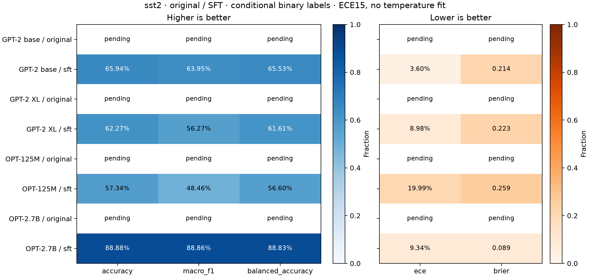
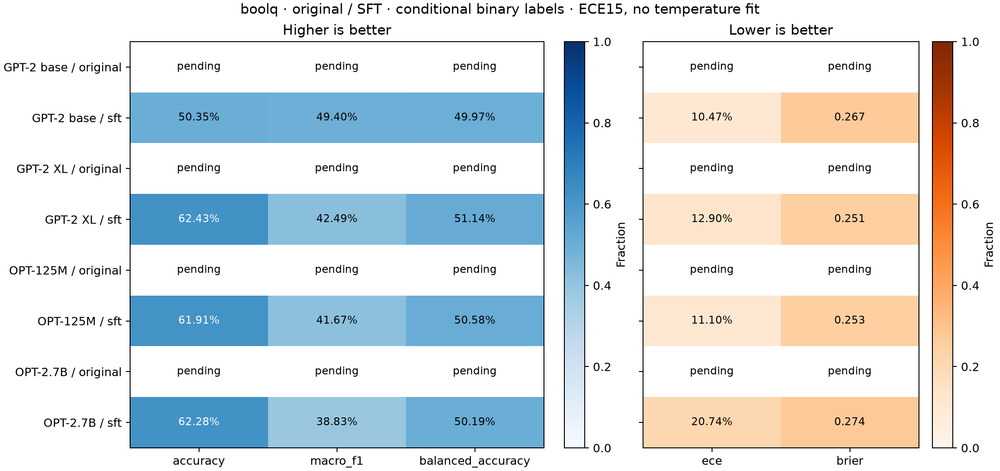

# 후보의 분류 편향과 calibration 진단

원본 0/4·SFT 4/4모델 완료. SST-2 872·BoolQ 3,269건의 고정 source row·label·파일 hash를 확인하고 기존 확률에서 지표를 재계산했다. 미완료 항목은 채우지 않는다.

두 label 후보의 조건부 sequence 확률로 판정한다. 자유 생성의 의미상 정답률이나 전체 어휘의 entropy confidence와 다르다. ECE는 Guo 공식 기본 15개 등폭 (lower,upper] bin이며 temperature를 학습하지 않는다. 본 생성 평가의 보조 진단이며 최종 조합을 accuracy 하나로 고르지 않는다.

| 모델 | 단계 | 자료 | Acc % | Macro-F1 % | Balanced Acc % | 다수 클래스 % | 양성 예측 % | ECE % ↓ | Brier ↓ |
|---|---|---|---:|---:|---:|---:|---:|---:|---:|
| GPT-2 base | sft | sst2 | 65.94 | 63.95 | 65.53 | 50.92 | 72.59 | 3.60 | 0.2137 |
| GPT-2 base | sft | boolq | 50.35 | 49.40 | 49.97 | 62.16 | 51.54 | 10.47 | 0.2672 |
| GPT-2 XL | sft | sst2 | 62.27 | 56.27 | 61.61 | 50.92 | 86.12 | 8.98 | 0.2234 |
| GPT-2 XL | sft | boolq | 62.43 | 42.49 | 51.14 | 62.16 | 96.73 | 12.90 | 0.2507 |
| OPT-125M | sft | sst2 | 57.34 | 48.46 | 56.60 | 50.92 | 90.60 | 19.99 | 0.2594 |
| OPT-125M | sft | boolq | 61.91 | 41.67 | 50.58 | 62.16 | 96.76 | 11.10 | 0.2530 |
| OPT-2.7B | sft | sst2 | 88.88 | 88.86 | 88.83 | 50.92 | 53.33 | 9.34 | 0.0891 |
| OPT-2.7B | sft | boolq | 62.28 | 38.83 | 50.19 | 62.16 | 99.76 | 20.74 | 0.2740 |

SST-2의 양성은 positive, BoolQ는 Yes다. weighted-F1·MCC·클래스별 recall은 [scores.csv](scores.csv), 혼동행렬과 15개 bin의 n·평균 confidence·정답률·ECE 기여도는 모델별 result.json에 있다. 빈 bin의 평균은 null이다. 예측 원문·문항별 확률은 Git에서 제외한 tmp에 보관한다.

