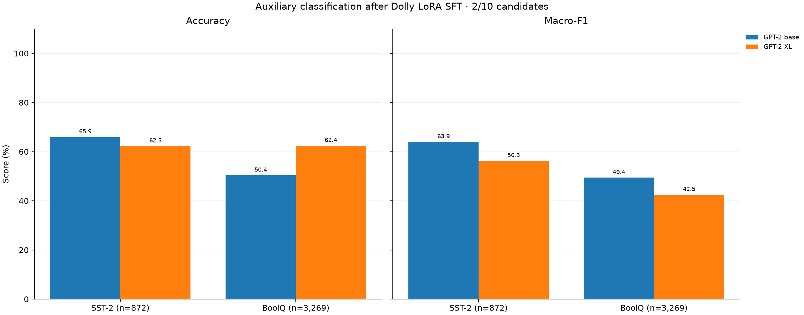
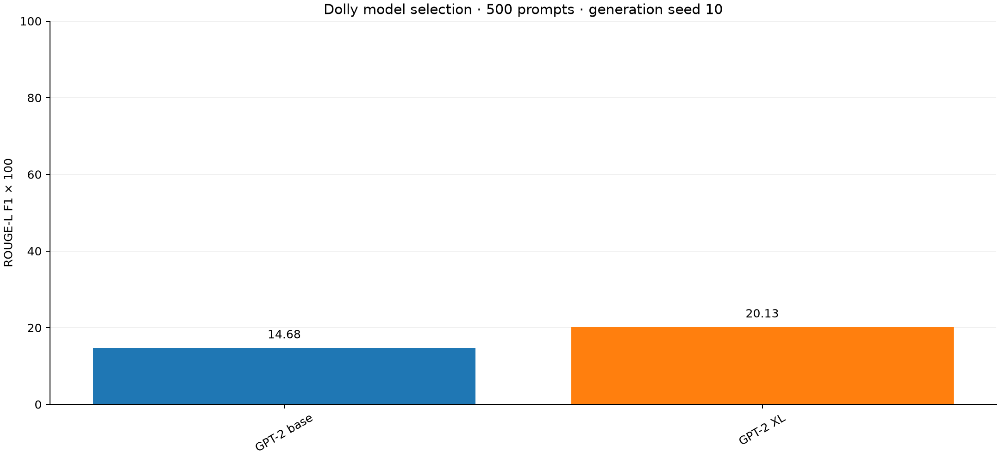
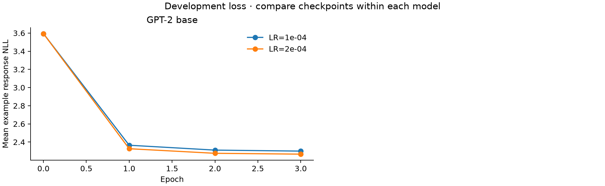

# 기존 Dolly·분류 보조 평가

교사·학생 선정의 주 자료는 [네 생성 벤치마크 비교](../generation_benchmarks_v1/REPORT.md)다. 아래 SST-2·BoolQ는 편향·확률 품질의 보조 진단이며, 현재 Brier score는 MiniLLM의 ECE 재현과 구분한다.

5개 계열·10개 모델 중 SFT 선택 완료 2/10, 기존 평가 완료 2/10. 이번 직접 LoRA SFT 결과이며 이전 공개 SFT 점수와 구분한다.

| 모델 | SST-2 Acc / macro-F1 (%) | BoolQ Acc / macro-F1 (%) | Dolly ROUGE-L (생성 seed 10) |
|---|---|---|---|
| GPT-2 base | 65.94 / 63.95 | 50.35 / 49.40 | 14.68 |
| GPT-2 XL | 62.27 / 56.27 | 62.43 / 42.49 | 20.13 |

모델 선정 단계는 생성 seed 10 한 개를 사용해 seed 간 변동을 추정하지 않는다. 최종 선정 모델의 본 실험에서는 생성 seed 10/20/30/40/50을 사용한다. 학습 seed 반복과 생성 seed 반복은 별개다. 모델 선정 자료이므로 독립적인 최종 test가 아니다.

검증 손실 곡선은 각 에포크 종료 시 측정값을 표시한다. 학습 종료 후 최적 checkpoint를 복원해 재평가한 값은 해당 에포크의 추가 측정으로 표시하지 않는다.

