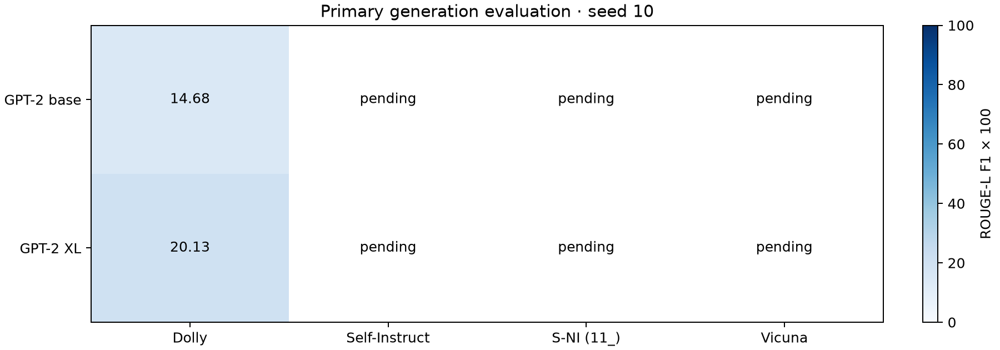
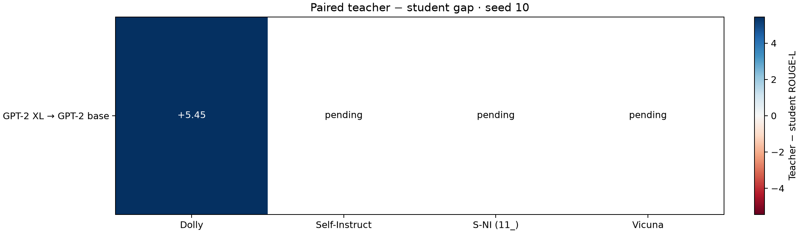

# 생성 벤치마크의 교사·학생 비교

주 평가: 네 생성 benchmark. 완료 0/10모델. SST-2·BoolQ는 [보조 분류 진단](../dolly_sft_v1/REPORT.md)으로 분리한다.

모든 모델에 동일 원문 ID·새 토큰 예산 256·생성 seed 10을 적용한다. 원 논문 그대로의 재현은 아니다. 단일 seed이므로 seed 간 SD와 오차막대를 표시하지 않는다. ROUGE는 정답과의 겹침을 측정하며 사실성이나 사람의 선호를 직접 측정하지 않는다.

| 모델 | Dolly | Self-Instruct | S-NI (11_) | Vicuna | 네 과제 평균 |
|---|---:|---:|---:|---:|---:|
| GPT-2 base | 14.68 | 대기 | 대기 | 대기 | — |
| GPT-2 XL | 20.13 | 대기 | 대기 | 대기 | — |

과제 평균은 네 benchmark 평균에 같은 가중치를 준 값이며 전체 문항을 합친 평균과 다르다. 미완료 모델은 평균을 계산하지 않는다. 교사의 자격에 임의의 최소 점수 차이를 두지 않는다.

## 동일 문항의 교사−학생 차이

| 조합 | Benchmark | 평균 ROUGE-L 차이 | 교사 우위 / 동률 / 학생 우위 문항 |
|---|---|---:|---|
| GPT-2 XL → GPT-2 base | Dolly | +5.45 | 317 / 31 / 152 |

우위 문항 수는 동일 문항의 ROUGE-L 비교이며 사람의 선호 승률이 아니다. 이 결과는 모델 선정 자료이므로 독립적인 최종 test로 취급하지 않는다.

## 자료와 전처리

| Benchmark | 공식 배포 행 수 | 공통 평가 행 수 | 제외 행 수 |
|---|---:|---:|---:|
| Dolly | 500 | 500 | 0 |
| Self-Instruct | 242 | 242 | 0 |
| S-NI (11_) | 1694 | 1694 | 0 |
| Vicuna | 80 | 80 | 0 |

S-NI는 MiniLLM의 공식 `11_` 배포 구간을 사용한다. 다중 정답은 지표별 최고 점수를 사용한다. 학습·개발 집합과 정규화 instruction이 같은 문항 및 어느 모델에서든 native context를 넘는 문항은 출력 확인 전에 공통 제외한다. 문항·응답을 자르거나 성능에 따라 재선정하지 않는다. 중복 prompt는 원문대로 보존하고 수를 protocol에 기록한다. 의미상 누수 전체를 감사한 것은 아니다.

