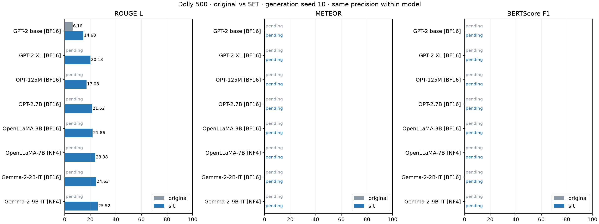

# 원본과 Dolly SFT의 생성 평가 비교

완료: 원본 Dolly 1/8, SFT Dolly 8/8, 보완 채점 원본 0/8·SFT 0/8. 최종 조합은 후보 후속 검증 후 선정한다.

동일 원문 ID·prompt·모델별 정밀도·생성 seed 10·새 토큰 상한 256의 결과다. 원본은 우리 Dolly SFT 전 checkpoint이며 Gemma-IT는 이미 instruction tuning을 거친 모델이다. 미완료 점수는 공란으로 두고 완료한 응답·CSV·명세 hash와 지표를 재검산한다.

ROUGE-L·METEOR·raw BERTScore F1은 ×100이다. Distinct-4는 corpus 고유/전체 4-gram 비율이며 클수록 사실성이나 성능이 좋다는 뜻이 아니다. 단일 seed이므로 seed 간 SD·오차막대는 없다. 아래 결과만으로 최종 조합을 자동 선정하지 않는다.

| 모델 | 단계 | Dolly ROUGE-L | METEOR | BERTScore F1 | Distinct-4 |
|---|---|---:|---:|---:|---:|
| GPT-2 base | original | 6.16 | — | — | — |
| GPT-2 base | sft | 14.68 | — | — | — |
| GPT-2 XL | original | — | — | — | — |
| GPT-2 XL | sft | 20.13 | — | — | — |
| OPT-125M | original | — | — | — | — |
| OPT-125M | sft | 17.08 | — | — | — |
| OPT-2.7B | original | — | — | — | — |
| OPT-2.7B | sft | 21.52 | — | — | — |
| OpenLLaMA-3B | original | — | — | — | — |
| OpenLLaMA-3B | sft | 21.86 | — | — | — |
| OpenLLaMA-7B | original | — | — | — | — |
| OpenLLaMA-7B | sft | 23.98 | — | — | — |
| Gemma-2-2B-IT | original | — | — | — | — |
| Gemma-2-2B-IT | sft | 24.63 | — | — | — |
| Gemma-2-9B-IT | original | — | — | — | — |
| Gemma-2-9B-IT | sft | 25.92 | — | — | — |

## SFT − 원본

| 모델·조합 | 단계 | 자료 | 지표 | 평균 차이 | 증가 / 동률 / 감소 문항 |
|---|---|---|---|---:|---|
| GPT-2 base | sft−original | dolly | ROUGE-L | +8.52 | 374 / 31 / 95 |

## 교사 − 학생

| 모델·조합 | 단계 | 자료 | 지표 | 평균 차이 | 증가 / 동률 / 감소 문항 |
|---|---|---|---|---:|---|
| GPT-2 XL → GPT-2 base | sft | dolly | ROUGE-L | +5.45 | 317 / 31 / 152 |
| GPT-2 XL → GPT-2 base | sft | self_inst | ROUGE-L | +5.29 | 137 / 31 / 74 |
| GPT-2 XL → GPT-2 base | sft | sni_11 | ROUGE-L | +8.95 | 1156 / 47 / 491 |
| GPT-2 XL → GPT-2 base | sft | vicuna | ROUGE-L | +2.72 | 54 / 0 / 26 |
| OPT-2.7B → OPT-125M | sft | dolly | ROUGE-L | +4.44 | 302 / 38 / 160 |
| OpenLLaMA-7B → OpenLLaMA-3B | sft | dolly | ROUGE-L | +2.12 | 258 / 32 / 210 |
| Gemma-2-9B-IT → Gemma-2-2B-IT | sft | dolly | ROUGE-L | +1.29 | 242 / 30 / 228 |

문항 수는 해당 자동 지표의 대응 차이이며 사람의 선호 승률이 아니다. 교사−학생 차이와 SFT−원본 차이, 이후 본 KD 학생−동일 SFT 학생의 개선을 구분한다.

## BERTScore 길이 감사

| 모델 | 단계 | 자료 | reference 영향 문항 | 응답 영향 문항 | 전체 reference 수 |
|---|---|---|---:|---:|---:|

BERTScore encoder의 native 상한은 특수 토큰 포함 512다. METEOR·ROUGE는 전체 reference를 사용한다. 세부 토큰 수·고유/전체 4-gram 수는 각 결과 CSV·JSON에 남긴다.

전체 지표: [scores.csv](scores.csv), 대응 차이와 입력 근거: [comparisons.json](comparisons.json). 최종 선정에는 후보의 외부 평가·보조 분류/보정 진단·응답 검토·실제 증류 경로 점검이 남아 있다.
